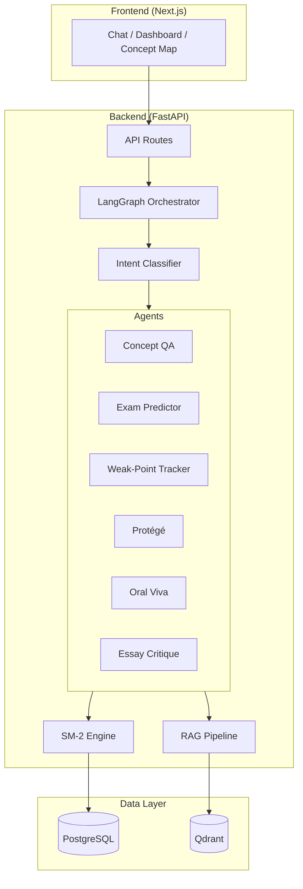

# EduAgent — Screenshot Capture Guide for IEEE Paper

## Overview

Your IEEE paper (`docs/EduAgent_IEEE_Paper.html`) has 7 figure placeholders. This guide tells you exactly which screenshots to capture and how to insert them.

---

## Setup Before Capturing

1. Run the platform: `docker compose up --build`
2. Seed demo data: `docker compose -f docker-compose.prod.yml run seed`
3. Log in as `demo@eduagent.com` / `demo123`
4. Upload at least 1 PDF per subject (Admin > Upload) so RAG sources appear
5. Have a few conversations so the dashboard is populated
6. Set browser zoom to 100%
7. Use **dark mode** for consistency (or light mode — pick one and stick with it)
8. Use `Win + Shift + S` (Windows) or `Cmd + Shift + 4` (Mac) for clean screenshots
9. Save all screenshots to `docs/screenshots/` folder

---

## Figure-by-Figure Guide

### Figure 1: System Architecture Diagram
**Paper section**: Section IV — System Architecture

**What to capture**: Create or use the architecture diagram from `ARCHITECTURE.md`. Options:
- Use draw.io / Excalidraw to create a clean diagram showing:
  - Frontend (Next.js) → API Gateway (FastAPI) → LangGraph Orchestrator
  - Orchestrator → 6 Agent boxes
  - Shared data layer: PostgreSQL, Qdrant, Student State
  - RAG pipeline: PDF → Chunker → Embeddings → Qdrant

**Filename**: `docs/screenshots/fig1_architecture.png`

---

### Figure 2: LangGraph Orchestrator Flow
**Paper section**: Section V — Agent Design

**What to capture**: The LangGraph state graph flow. Options:
- Screenshot the graph from LangGraph's built-in visualization
- Or create a flowchart showing:
  ```
  load_state → classify_intent → [conditional routing] →
  agent_qa / agent_exam / agent_weak / agent_protege / agent_viva / agent_critique
  → commit_state → format_response → END
  ```

**Filename**: `docs/screenshots/fig2_orchestrator_flow.png`

---

### Figure 3: Chat Interface with Agent Trace
**Paper section**: Section V — Agent Design

**What to capture**:
1. Go to Chat, select a subject
2. Send a message like "Explain polymorphism in OOP"
3. Wait for the streaming response to complete
4. Expand the agent trace panel (right side) showing:
   - Intent classification result
   - RAG sources with scores
   - Agent type
5. Screenshot the full chat view with the trace panel visible

**Filename**: `docs/screenshots/fig3_chat_with_trace.png`

---

### Figure 4: Dashboard — Mastery Heatmap + Exam Readiness
**Paper section**: Section VIII — Student Dashboard

**What to capture**:
1. Go to Dashboard
2. Select a subject with seeded data
3. Screenshot showing:
   - Overall mastery ring chart (top left)
   - Exam readiness gauge (top center)
   - Study activity card (top right)
   - Mastery heatmap below (colour-coded concepts)

**Filename**: `docs/screenshots/fig4_dashboard.png`

---

### Figure 5: Concept Graph Visualization
**Paper section**: Section VIII — Student Dashboard

**What to capture**:
1. Go to Concept Map
2. Select a subject with seeded concepts + prerequisites
3. Zoom to show a good cluster of 10-15 connected nodes
4. Ensure nodes show different colours (mastered = green, weak = red/orange)
5. Screenshot the full graph view

**Filename**: `docs/screenshots/fig5_concept_graph.png`

---

### Figure 6: Protégé Mode Teaching Session
**Paper section**: Section V.D — Protégé Agent

**What to capture**:
1. Start a new chat, select a subject
2. Type "Let me teach you about [concept]"
3. Have a 3-4 exchange conversation where the AI asks questions
4. Type "how did I do?" to trigger evaluation
5. Screenshot the evaluation showing the structured rubric (score, strengths, gaps)

**Filename**: `docs/screenshots/fig6_protege_evaluation.png`

---

### Figure 7: Weak Points Analysis with Suggestions
**Paper section**: Section VIII — Student Dashboard

**What to capture**:
1. Go to Dashboard, scroll to "Weak Points" card
2. Screenshot showing:
   - List of weak concepts with priority tags
   - Prerequisite gap identification
   - Actionable study suggestions
   - Total weak vs total concepts count

**Filename**: `docs/screenshots/fig7_weak_points.png`

---

## Inserting Screenshots into the IEEE Paper

### Option A: Edit the HTML directly
Open `docs/EduAgent_IEEE_Paper.html` and replace each placeholder like:
```html
<!-- Replace with actual screenshot -->
<p>[Figure X placeholder]</p>
```
with:
```html

```

### Option B: Insert into the Word (.docx) version
1. Open `docs/EduAgent_IEEE_Paper.docx` in Word
2. Find each `[FIGURE X PLACEHOLDER]` text
3. Insert > Picture > select the corresponding screenshot
4. Right-click the image > Size > set width to ~3.5 inches (single column) or ~7 inches (full width)
5. Add caption below: "Fig. X. [Description]"

---

## Image Formatting Requirements (IEEE)

- **Resolution**: At least 300 DPI for print
- **Width**: 
  - Single column figure: 3.5 inches (88 mm)
  - Double column figure: 7.16 inches (181 mm)
- **Format**: PNG (for screenshots), SVG/PDF (for diagrams)
- **Caption**: Always below the figure, formatted as "Fig. X. Description."
- **Font in images**: Use sans-serif, minimum 8pt
- **Colour**: Use colour sparingly — ensure figures are readable in greyscale too

---

## Bonus: Quick Architecture Diagram Creation

If you want a polished architecture diagram, use one of:

1. **draw.io** (free, browser-based): https://app.diagrams.net/
2. **Excalidraw** (free, hand-drawn style): https://excalidraw.com/
3. **Mermaid** (text-based, paste into GitHub README):


